## A. Conflicts

| ID | BR | ERD element | Problem | My fix |
| --- | --- | --- | --- | --- |
| C01 | BR-01 | CENTERS.id / BRANCHES.center_id | The ERD allows a center to exist without any branches, although every center must own at least one branch. | Represent the relationship as 1..N and enforce the minimum through the center-provisioning workflow before activation. |
| C02 | BR-01, BR-02 | SESSIONS.course_id / SESSIONS.branch_id | Independent foreign keys allow a session to reference a course and a branch belonging to different centers. | Add `SESSIONS.center_id` and composite foreign keys to enforce ownership consistency. |
| C03 | BR-03 | COURSES.price | Course-level pricing cannot represent different seat prices across sessions of the same course. | Move the current seat price to `SESSIONS.price`. |
| C04 | BR-05 | WALLETS.balance | FLOAT cannot reliably represent exact decimal amounts required for financial operations. | Use `NUMERIC(18,2)` with a nonnegative balance constraint. |
| C05 | BR-05 | WALLETS.balance | A directly mutable balance can diverge from the recorded financial transaction history. | Treat the append-only ledger as the source of truth and update the cached balance atomically with every ledger entry. |
| C06 | BR-05 | WALLET_TRANSACTIONS.amount | FLOAT introduces precision errors in charges, top-ups, and refunds. | Use signed `NUMERIC(18,2)` amounts with a nonzero amount constraint. |
| C07 | BR-05 | WALLET_TRANSACTIONS.updated_at | Mutable financial transaction records violate the append-only ledger requirement. | Remove `updated_at` and prohibit UPDATE and DELETE operations on ledger records at the database level. |
| C08 | BR-05, BR-10 | WALLET_TRANSACTIONS.wallet_id | A wallet reference alone cannot identify the booking or business operation responsible for a charge or refund. | Add `booking_id`, `type`, and a unique `operation_key` for traceability and repeat-safe financial operations. |
| C09 | BR-06 | BOOKINGS.status | The `pending` status does not explicitly represent the waitlist, while `cancelled` does not identify who initiated cancellation. | Use `confirmed`, `waitlisted`, `cancelled_by_student`, and `cancelled_by_center`. |
| C10 | BR-06 | BOOKINGS.id | The ERD does not define a deterministic FIFO tie-breaker when waitlisted bookings have identical timestamps. | Order waitlisted bookings by `(created_at, id)` and provide a supporting partial index. |
| C11 | BR-07 | SESSIONS.starts_at / COURSES.duration_minutes | A start timestamp alone does not explicitly define the session interval required for overlap detection. | Store `SESSIONS.ends_at`, calculated from the course duration when scheduling the session. |
| C12 | BR-07 | BOOKINGS.student_id / BOOKINGS.session_id | The ERD does not prevent multiple active bookings for the same student and session, while unconditional uniqueness would prevent rebooking after cancellation. | Add a partial unique index on `(student_id, session_id)` for `confirmed` and `waitlisted` bookings only. |
| C13 | BR-08 | BRANCHES.city / SESSIONS.starts_at | A city name does not explicitly define an IANA time zone, while timezone-naive timestamps can cause incorrect cancellation boundaries. | Add `BRANCHES.timezone` and store session instants using `TIMESTAMPTZ`. |
| C14 | BR-09 | CENTERS.commission_rate | Reading the current center commission rate can change the calculated commission of historical bookings after contract updates. | Snapshot the commission rate and calculated commission amount in `BOOKINGS` when confirmation occurs. |
| C15 | BR-03, BR-09 | BOOKINGS | The ERD does not preserve the confirmed seat price, so later session price changes can affect historical financial calculations. | Store `charged_amount` and `confirmed_at` upon confirmation, leaving them NULL while waitlisted. |
| C16 | BR-10 | SESSIONS | The ERD cannot distinguish an active session from one cancelled by its center. | Add session `status` and `cancelled_at`, while preserving the cancellation origin in booking statuses. |
| C17 | BR-10 | WALLET_TRANSACTIONS.wallet_id | Retrying a center cancellation can create duplicate refunds or refund more than the original booking charge. | Enforce one refund per booking and refund type with a partial unique index and deterministic keys; cap total refunds at the original charge. |
| C18 | BR-11 | BOOKINGS | The model cannot distinguish a retried HTTP request from a new booking attempt or reproduce its original response. | Add `IDEMPOTENCY_REQUESTS` with student-scoped keys, request fingerprints, HTTP status codes, and stored responses. |
| C19 | BR-12 | CENTERS.id | The ERD provides no manager-to-center association for enforcing center-specific data access. | Add `CENTER_MANAGERS` for future manager authorization and require every report query to be scoped to an authorized center. |

## B. Questions

| ID | Question to the analyst | Assumption I took |
| --- | --- | --- |
| Q1 | What currency is used for session prices and student wallets in Syria and Oman, and is currency conversion supported? | Use USD as the platform's single accounting currency, without currency conversion. |
| Q2 | Should both confirmed and waitlisted bookings block new bookings for overlapping sessions, and what happens to ineligible candidates during promotion? | Reject overlapping bookings when either existing or requested booking is active (`confirmed` or `waitlisted`). Recheck eligibility during promotion, skip and notify ineligible candidates, and leave them waitlisted. |
| Q3 | Is the seat price locked when a student joins the waitlist, or determined when the booking becomes confirmed? | Charge the session's current price at promotion time and snapshot both the price and center commission at confirmation. |
| Q4 | If a center cancels a session, should a student who previously cancelled and received a partial refund receive the remaining amount? | Yes; the total refunds for a paid booking may reach 100% of its original charge but must never exceed that amount. |
| Q5 | How should monthly gross revenue, commission, net revenue, and occupancy be defined, and which date determines the reporting month? | Group sessions by their start dates in each branch's local calendar month; report gross confirmed charges, deduct refunds, reverse commission proportionally, and calculate occupancy using currently confirmed seats divided by scheduled capacity. |

## C. Revised ERD

```mermaid
erDiagram

    CENTERS ||--|{ BRANCHES : owns
    CENTERS ||--o{ COURSES : offers
    CENTERS ||--o{ SESSIONS : schedules
    CENTERS ||--o{ CENTER_MANAGERS : assigns

    COURSES ||--o{ SESSIONS : scheduled_as
    BRANCHES ||--o{ SESSIONS : hosts

    STUDENTS ||--|| WALLETS : owns
    WALLETS ||--o{ WALLET_TRANSACTIONS : records

    STUDENTS ||--o{ BOOKINGS : makes
    SESSIONS ||--o{ BOOKINGS : receives

    BOOKINGS o|--o{ WALLET_TRANSACTIONS : generates
    STUDENTS ||--o{ IDEMPOTENCY_REQUESTS : submits

    CENTERS {
        bigint id PK
        varchar name
        numeric commission_rate
        timestamp created_at
    }

    BRANCHES {
        bigint id PK
        bigint center_id FK
        varchar name
        varchar city
        varchar timezone
    }

    COURSES {
        bigint id PK
        bigint center_id FK
        varchar title
        int duration_minutes
    }

    SESSIONS {
        bigint id PK
        bigint center_id FK
        bigint course_id FK
        bigint branch_id FK
        timestamptz starts_at
        timestamptz ends_at
        numeric price
        int capacity
        varchar status
        timestamptz cancelled_at
    }

    STUDENTS {
        bigint id PK
        varchar full_name
        varchar phone UK
    }

    WALLETS {
        bigint id PK
        bigint student_id FK,UK
        numeric balance
    }

    WALLET_TRANSACTIONS {
        bigint id PK
        bigint wallet_id FK
        bigint booking_id FK
        varchar type
        numeric amount
        varchar operation_key UK
        timestamptz created_at
    }

    BOOKINGS {
        bigint id PK
        bigint student_id FK
        bigint session_id FK
        varchar status
        numeric charged_amount
        numeric commission_rate_snapshot
        numeric commission_amount
        timestamptz confirmed_at
        timestamptz cancelled_at
        timestamptz created_at
    }

    IDEMPOTENCY_REQUESTS {
        bigint id PK
        bigint student_id FK
        varchar idempotency_key
        varchar request_hash
        int response_status
        jsonb response_body
        timestamptz created_at
    }

    CENTER_MANAGERS {
        bigint id PK
        bigint center_id FK
        varchar full_name
        varchar email UK
        timestamptz created_at
    }

    %% =========================================================
    %% 1. CENTER OWNERSHIP AND RELATIONSHIPS
    %% =========================================================

    %% A center must have at least one branch before activation.
    %% Enforce this through the center-provisioning workflow.
    %% ERD cardinality alone cannot enforce this minimum in SQL.

    %% Prevent sessions from referencing courses and branches
    %% that belong to different centers.

    %% UNIQUE courses(id, center_id)
    %% UNIQUE branches(id, center_id)

    %% FK sessions(course_id, center_id)
    %%    REFERENCES courses(id, center_id)

    %% FK sessions(branch_id, center_id)
    %%    REFERENCES branches(id, center_id)

    %% CHECK centers.commission_rate BETWEEN 0 AND 100
    %% CHECK courses.duration_minutes > 0

    %% =========================================================
    %% 2. SESSION INTEGRITY
    %% =========================================================

    %% NUMERIC(18,2) for sessions.price.
    %% CHECK sessions.price >= 0
    %% CHECK sessions.capacity > 0
    %% CHECK sessions.ends_at > sessions.starts_at

    %% Allowed session statuses:
    %% scheduled, cancelled

    %% CHECK sessions.status IN ('scheduled', 'cancelled')

    %% Sessions use TIMESTAMPTZ for actual time instants.
    %% Branches use IANA time zones:
    %% Asia/Damascus, Asia/Muscat.

    %% ends_at is calculated from the course duration
    %% when the session is initially scheduled.

    %% INDEX sessions(branch_id, starts_at)

    %% =========================================================
    %% 3. WALLET AND FINANCIAL LEDGER
    %% =========================================================

    %% One wallet per student:
    %% UNIQUE wallets(student_id)

    %% Financial values use NUMERIC(18,2).
    %% CHECK wallets.balance >= 0
    %% CHECK wallet_transactions.amount <> 0

    %% The append-only wallet_transactions ledger
    %% is the source of truth for wallet balances.

    %% wallets.balance is a cached projection of the ledger.
    %% Ledger inserts and balance updates must be atomic.

    %% Financial transactions must never be updated or deleted.
    %% Enforce immutability with database permissions
    %% or database triggers.

    %% Allowed transaction types:
    %% topup
    %% booking_charge
    %% student_refund
    %% center_refund

    %% Amount signs:
    %% topup > 0
    %% booking_charge < 0
    %% student_refund > 0
    %% center_refund > 0

    %% Enforce transaction type and amount sign consistency.

    %% booking_id is NULL for wallet top-ups.
    %% Booking charges and refunds must reference a booking.

    %% UNIQUE wallet_transactions(operation_key)

    %% CREATE UNIQUE INDEX uq_wallet_transactions_refund_once
    %% ON wallet_transactions(booking_id, type)
    %% WHERE type IN ('student_refund', 'center_refund');

    %% INDEX wallet_transactions(wallet_id, created_at, id)
    %% INDEX wallet_transactions(booking_id, type)

    %% All refunds for a booking combined must not exceed
    %% the original charged amount.

    %% =========================================================
    %% 4. BOOKING STATUS AND UNIQUENESS
    %% =========================================================

    %% Allowed booking statuses:
    %% confirmed
    %% waitlisted
    %% cancelled_by_student
    %% cancelled_by_center

    %% CHECK bookings.status IN (
    %%   'confirmed',
    %%   'waitlisted',
    %%   'cancelled_by_student',
    %%   'cancelled_by_center'
    %% )

    %% A student cannot have multiple active bookings
    %% for the same session.

    %% CREATE UNIQUE INDEX uq_bookings_active_student_session
    %% ON bookings(student_id, session_id)
    %% WHERE status IN ('confirmed', 'waitlisted');

    %% Cancelled bookings are excluded from this index.
    %% This permits rebooking the same session after cancellation.

    %% Confirmation snapshots:
    %% charged_amount
    %% commission_rate_snapshot
    %% commission_amount
    %% confirmed_at

    %% Financial snapshots are NULL while waitlisted.
    %% They are assigned only when the booking is confirmed.

    %% CHECK charged_amount >= 0 when not NULL.
    %% CHECK commission_amount >= 0 when not NULL.
    %% CHECK status != 'confirmed' OR all snapshots are NOT NULL.

    %% Historical confirmation snapshots must remain unchanged
    %% when session prices or center commission rates change.

    %% =========================================================
    %% 5. WAITLIST ORDERING AND PROMOTION
    %% =========================================================

    %% FIFO order:
    %% ORDER BY created_at ASC, id ASC

    %% CREATE INDEX idx_bookings_waitlist_fifo
    %% ON bookings(session_id, created_at, id)
    %% WHERE status = 'waitlisted';

    %% Promotion eligibility must be checked at promotion time.

    %% Validate:
    %% - Sufficient wallet balance
    %% - No overlapping active booking, excluding this booking
    %% - Booking remains waitlisted
    %% - Session remains scheduled

    %% Ineligible students are skipped and notified.
    %% They remain waitlisted for future opportunities.

    %% The session's current price and commission rate
    %% are snapshotted at confirmation.

    %% =========================================================
    %% 6. TEMPORAL OVERLAP
    %% =========================================================

    %% Session intervals use:
    %% starts_at and ends_at.

    %% Two sessions overlap when:
    %% existing.starts_at < requested.ends_at
    %% AND requested.starts_at < existing.ends_at

    %% Confirmed and waitlisted bookings both block new
    %% overlapping confirmed or waitlisted bookings.

    %% Student booking decisions must be serialized
    %% during booking confirmation and waitlist promotion.

    %% INDEX bookings(student_id, status, session_id)

    %% =========================================================
    %% 7. CANCELLATION AND REFUNDS
    %% =========================================================

    %% Student cancellation policy:
    %% >= 48 hours before session: 100% refund
    %% >= 12 and < 48 hours: 50% refund
    %% < 12 hours: 0% refund

    %% Cancellation calculations use branch-local scheduling
    %% and timezone-aware session timestamps.

    %% Center cancellation may refund the remaining balance
    %% for bookings already partially refunded.

    %% Total refunded amount must never exceed charged_amount.

    %% Use deterministic refund operation keys:
    %% booking:{id}:student_refund
    %% booking:{id}:center_refund

    %% Refund entries, cached wallet updates, and booking
    %% status changes must be committed atomically.

    %% =========================================================
    %% 8. IDEMPOTENCY
    %% =========================================================

    %% UNIQUE idempotency_requests(student_id, idempotency_key)

    %% Request fingerprints include:
    %% HTTP method, target session, and raw request body.

    %% Same key and same fingerprint:
    %% Return the previously stored successful response.

    %% Same key and different fingerprint:
    %% Reject without repeating the business operation.

    %% Persist booking effects and successful idempotency response
    %% atomically in the same database transaction.

    %% =========================================================
    %% 9. CENTER MANAGERS AND REPORTING
    %% =========================================================

    %% CENTER_MANAGERS represents center-scoped management.

    %% UNIQUE center_managers(email)
    %% INDEX center_managers(center_id)

    %% Manager reporting must be restricted
    %% to the associated center.

    %% Monthly reports use the branch's local calendar month
    %% based on sessions.starts_at.

    %% Gross revenue:
    %% Sum of confirmed booking charges.

    %% Refunds:
    %% Sum of all applicable refund transactions.

    %% Net collected revenue:
    %% Gross revenue minus refunds.

    %% Platform commission:
    %% Original commission snapshots adjusted
    %% proportionally for refunded amounts.

    %% Net center revenue:
    %% Net collected revenue minus platform commission.

    %% Occupancy:
    %% Currently confirmed bookings / total scheduled capacity.

    %% Financial reports must use historical booking snapshots
    %% and immutable ledger transactions.
    %% Never recalculate past prices or commissions
    %% using current session or center values.
```

